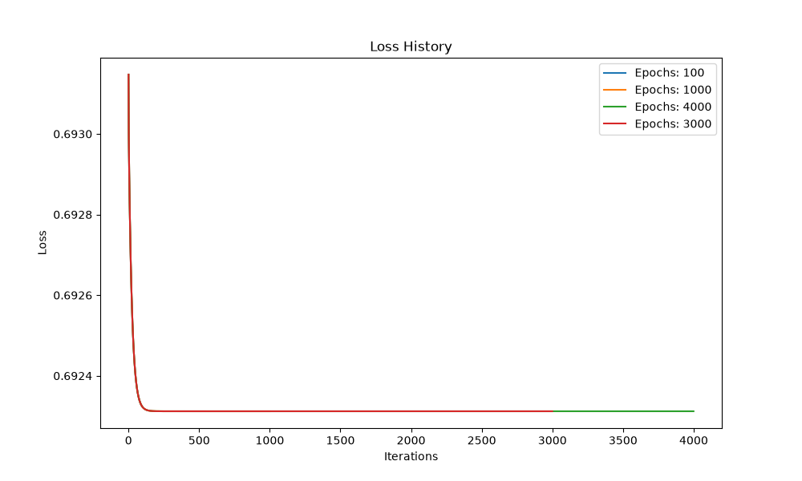
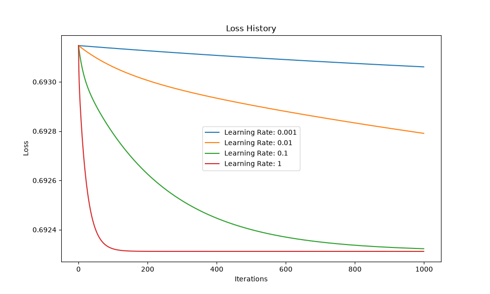

# Logistic Regression from Scratch: Training Analysis

## Objective

This experiment evaluates a logistic regression implementation using NumPy gradient descent. The model minimizes binary cross-entropy loss and uses a sigmoid activation to convert linear predictions into probabilities.

The goal is to examine how the number of training iterations and the learning rate affect convergence.

## Implementation

The implementation:

- Initializes the weights to zero and the bias to zero.
- Computes class probabilities using a sigmoid function.
- Computes binary cross-entropy loss.
- Updates weights and bias using batch gradient descent.
- Records the loss after every training iteration.

The experiments use 300 samples with two features and randomly generated binary labels. All models were trained on the same dataset.

## Effect of the Number of Epochs

The plot compares 100, 1,000, 3,000, and 4,000 training epochs with a learning rate of `1.0`.

All curves decrease rapidly during the early iterations and then become nearly flat. This indicates that the model reached an approximately stable solution well before 1,000 iterations.

The 100-epoch model stops before the remaining curves, while the longer runs continue for additional iterations but show little or no improvement after convergence. Extending training beyond roughly 1,000 iterations does not produce a meaningful reduction in loss for this dataset.

This result also demonstrates diminishing returns: additional epochs consume more computation without providing a comparable improvement in training loss.

## Effect of the Learning Rate

The learning-rate experiment compares values of `0.001`, `0.01`, `0.1`, and `1.0` over 1,000 iterations.

- A learning rate of `0.001` converges very slowly.
- A learning rate of `0.01` also converges slowly and remains above the better final loss after 1,000 iterations.
- A learning rate of `0.1` decreases the loss steadily and approaches convergence.
- A learning rate of `1.0` reduces the loss most quickly and reaches the lowest apparent plateau within a small fraction of the 1,000 iterations.

The learning rate therefore has a substantial effect on both convergence speed and how much progress is possible within a fixed number of iterations.

## Interpretation

For this implementation and dataset:

- `1.0` is the most effective learning rate among those tested.
- `0.1` is also effective, but it requires more iterations to converge.
- `0.001` and `0.01` are too small for efficient convergence within 1,000 iterations.
- Training beyond the point at which the loss plateaus provides limited benefit.

The rapid convergence is also affected by the scale and simplicity of the generated data. These conclusions should not be generalized to every dataset without further testing.

## Limitations

The experiment uses random labels, so the dataset does not contain a strong learnable relationship. Consequently, the loss plots describe optimization behavior rather than meaningful predictive performance.

The report does not currently include:

- Train/test split.
- Accuracy or other classification metrics.
- Generalization error.
- Comparison with scikit-learn.
- Feature scaling experiments.
- Tests for learning rates that might cause divergence.

## Conclusion

The loss-history plots show that gradient descent converges reliably for this implementation. A learning rate of `1.0` is fastest for the tested configuration, while lower learning rates require more iterations. Approximately 1,000 iterations are sufficient to reach the loss plateau with the largest learning rate.

Future experiments should use a structured dataset and evaluate held-out accuracy. That would separate optimization quality from model quality and determine whether the resulting parameters generalize to unseen data.